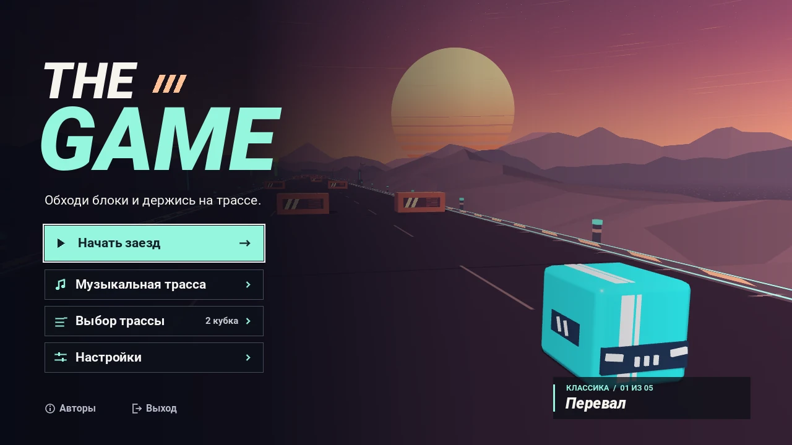
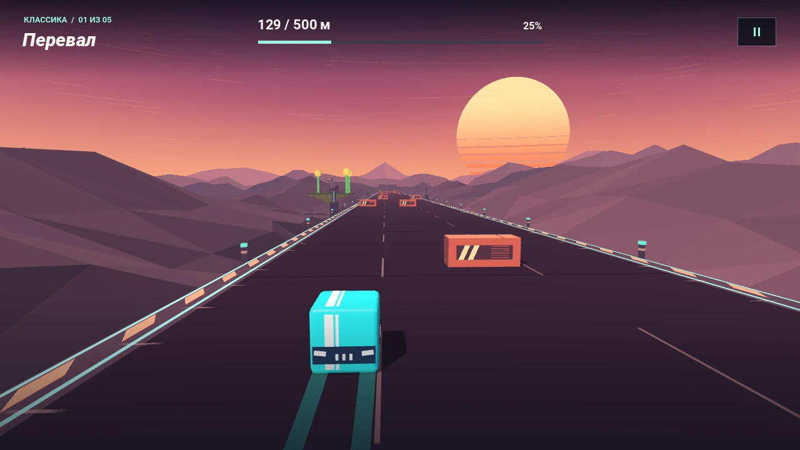
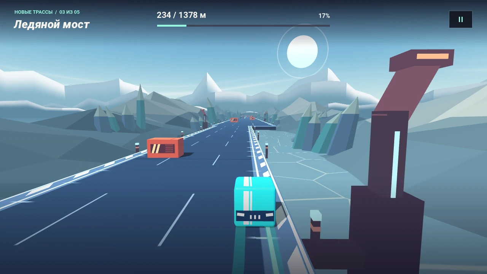
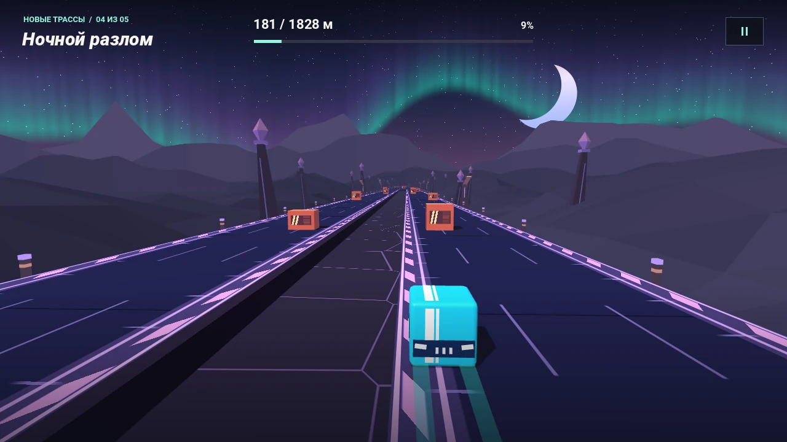
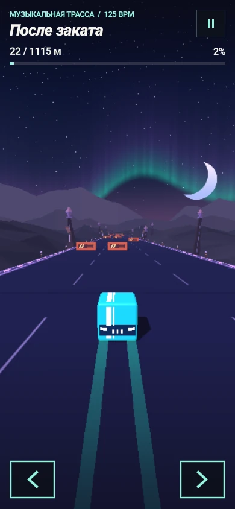

# THEGame

Аркадный 3D-раннер от **hacker-niki** для телефона и компьютера. Выбери песню, и её ритм станет трассой. В кампании тебя ждут пять уровней оригинальной Unity-игры и пять новых.

**[Играть в браузере](https://hacker-niki.github.io/THEGame/)** · [Android APK](https://github.com/hacker-niki/THEGame/releases/download/v2.0.0/THEGame-2.0.0-android.apk) · [Windows x86‑64](https://github.com/hacker-niki/THEGame/releases/download/v2.0.0/THEGame-2.0.0-windows-x86_64.zip) · [Linux x86‑64](https://github.com/hacker-niki/THEGame/releases/download/v2.0.0/THEGame-2.0.0-linux-x86_64.zip) · [Страница релиза](https://github.com/hacker-niki/THEGame/releases/tag/v2.0.0)



## Первый заезд

На телефоне открой игру в браузере или установи APK для Android. На компьютере распакуй архив и запусти `THEGame.exe` в Windows или `./THEGame.x86_64` в Linux. Если Linux не сохранил право запуска при распаковке, выполни `chmod +x THEGame.x86_64` в папке игры.

В меню **«Выбор трассы»** доступны первые уровни обоих кубков. **«Классика»** повторяет расположение препятствий пяти оригинальных уровней. В кубке **«Новые трассы»** есть развилки, узкие мосты и смещённые участки дороги. Каждый финиш открывает следующую трассу своего кубка. Игра запоминает открытые уровни и сколько процентов трассы удалось проехать. Рекорды времени хранятся отдельно для каждой сложности.

| Классика | Ледяной мост | Ночной разлом |
| :---: | :---: | :---: |
| [](docs/media/classic.webp) | [](docs/media/ice.webp) | [](docs/media/night.webp) |

## Музыкальная трасса

В главном меню выбери **«Музыкальная трасса»**. Возьми одно из двух демо или открой свой MP3, Ogg Vorbis или WAV длительностью от 6 секунд до 10 минут и размером до 64 МиБ. Игра расставит препятствия по ритму композиции. Игра обрабатывает звук на устройстве. Здесь нужны только повороты, заезд длится до конца трека.



## Управление

| Действие | Клавиатура | Геймпад |
| --- | --- | --- |
| Рулить | A / D или ← / → | Левый стик или крестовина |
| Тормозить | Пробел, S или ↓ | LT / L2 |
| Пауза | Esc или P | Start / Options |
| Повторить заезд | R | Y / △ |

Перед узким проходом удерживай тормоз. На сенсорном экране рули стрелками слева, а тормози кнопкой справа. В **«Настройках»** можно выбрать крейсерскую скорость — «Спокойно», «Аркада» или «Турбо».

## Из исходников

В Godot 4.7.2 открой проект и нажми **F5**. [Файл проекта](godot/project.godot)

Для запуска из терминала выполни обе команды в корне репозитория.

```sh
godot --headless --path godot --import
godot --path godot
```

Проверка кампании в Linux проходит все десять трасс через игровое управление, проверяет открытие уровней и повтор первого заезда. Команда создаёт отдельный временный профиль для теста.

```sh
XDG_DATA_HOME="$(mktemp -d)" godot --headless --path godot --fixed-fps 60 --script res://tests/campaign.gd
```

Исходная версия на Unity сохранена в [Assets](Assets), [Packages](Packages) и [ProjectSettings](ProjectSettings).
